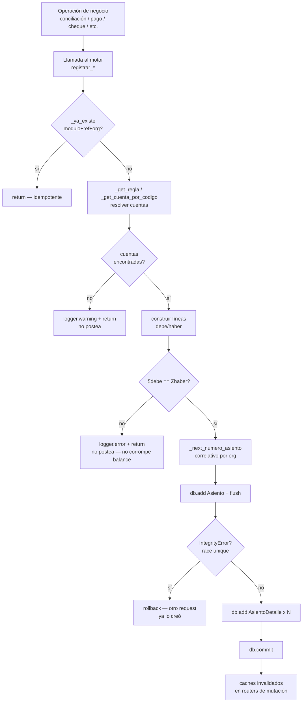

# Motor contable de partida doble

Deep dive del motor contable de Cuadra: cómo se genera, numera, reversa y reporta
cada asiento de partida doble que el sistema produce automáticamente.

Fuentes de verdad (código):
- `backend/app/services/motor_contable.py` — generación de asientos por módulo.
- `backend/app/services/seed_contable.py` — plan de cuentas + reglas sembradas por org.
- `backend/app/models/contabilidad.py` — modelos `PlanCuenta`, `ReglaContable`, `Asiento`, `AsientoDetalle`.
- `backend/app/routers/ctb_plan.py`, `ctb_libro.py`, `ctb_ctas_corrientes.py`, `ctb_clientes.py`, `ctb_common.py` — API de consulta/admin.

Cross-ref: [DOMAIN_MODEL](DOMAIN_MODEL.md) (entidades), [EVENTS](EVENTS.md) (qué dispara cada asiento),
[../business/BUSINESS_RULES](../business/BUSINESS_RULES.md) (reglas de negocio detrás de cada matriz de cuentas),
[../database/DATABASE_RULES](../database/DATABASE_RULES.md) (Decimal, índices, constraints).

---

## 1. Principios

El motor es un subsistema **pasivo y best-effort** que observa operaciones de los demás
módulos (conciliación, pagos, cheques, tarjetas, liquidaciones, ARCA) y genera el asiento
contable correspondiente. Cuatro invariantes:

1. **Encapsulado en try/except**: si falla la generación del asiento, la operación de
   negocio principal **no se revierte** (`db.rollback()` local + `logger.warning`, nunca
   propaga la excepción). El asiento es un efecto secundario, no parte de la transacción
   de negocio.
2. **Idempotente**: nunca crea dos asientos para el mismo `(modulo, referencia_id, org_id)`.
   Ver `_ya_existe()` y el índice único `uq_asiento_modulo_ref_org` (migración 006).
3. **Partida doble obligatoria**: todo asiento tiene Σdebe = Σhaber. Las funciones
   multilínea rechazan postear si no cuadra (red de seguridad, `> 0.01` de diferencia).
4. **Montos en `Decimal`**: todo cálculo monetario usa `Decimal`, nunca `float`
   (ver [DATABASE_RULES](../database/DATABASE_RULES.md), BUGS.md "Decimal vs float").
   `_monto()` normaliza cualquier entrada (`"15.000,50"`, `$`, `None`) a `Decimal` con 2 decimales.

---

## 2. Plan de Cuentas (`PlanCuenta`)

Árbol jerárquico de cuentas, sembrado por organización en `seed_contable.py`.

### Estructura

| Campo | Tipo | Significado |
|-------|------|-------------|
| `codigo` | String, indexado | Código jerárquico tipo `1-1-1-3-1` |
| `nombre` | String | Nombre legible |
| `tipo` | String | `activo` \| `pasivo` \| `resultado` (NULL en nodos sin propagar) |
| `parent_id` | FK self | Cuenta padre (jerarquía) |
| `nivel` | Integer | Profundidad (1 = raíz) |
| `activo` | Boolean | Soft-disable |
| `tasa_iva` | Numeric(5,4) | % IVA de la cuenta (0.21, 0.105, 0=exento, NULL=no aplica) — usado por el módulo IVA |
| `organizacion_id` | FK org | Multi-tenant |

El **código** codifica la jerarquía por segmentos (`A-B-C-D[-E]`): el primer dígito marca el
tipo raíz (`1`=Activo, `2`=Pasivo, `3`=Resultado). Una cuenta es **hoja** si ninguna otra la
tiene como `parent_id` (validado al postear ajustes manuales en `ctb_libro.py`).

### Cuentas sembradas (`PLAN` + `PLAN_PATCH`)

`PLAN` es el esqueleto base; `PLAN_PATCH` agrega cuentas de módulos posteriores y se
re-aplica en cada arranque (idempotente). Cuentas clave que el motor referencia por código:

| Código | Nombre | Tipo | Usada por |
|--------|--------|------|-----------|
| `1-1-1-2` | Efectivo | activo | egresos/ingresos en efectivo |
| `1-1-1-3` | Banco (madre) | activo | ya no la usa el motor (regla `carga_efectivo` solo aporta el Debe Efectivo); solo asientos viejos (`extracto`, `caja_efectivo`) |
| `1-1-1-3-1` | Banco Macro (hoja) | activo | **solo** datos del banco: `extracto_banco`, `um_lote`/`um_mov` y sus `_corregido` (ver §2bis) |
| `1-1-2-1` | Cheques en cartera | activo | cheques |
| `1-1-2-4/5/6` | IVA Crédito Fiscal / Percepciones IIBB / Retenciones | activo | tarjetas |
| `2-1-0-0` | Pasivo Corriente (rubro) | pasivo | ya no lo usa el motor; solo asientos viejos (`extracto`, `reclass_planilla_extracto`) |
| `2-1-1-1` | No identificado = **cobros a imputar** | pasivo | transitoria: crédito del banco (H) / reclasificación, cheque acreditado, tarjeta (D) |
| `2-1-1-2` | **Pagos a imputar** (oct 2026) | pasivo | transitoria: débito del banco (D) / pago por banco, rechazo, liquidación (H) |
| `2-1-2-0` | Cliente (nodo padre) | pasivo | padre de las cuentas corrientes de cliente |
| `2-1-2-X` | una cuenta por cliente (ej. Cliente Norte) | pasivo | cuenta corriente por cliente |
| `2-1-3-1` | Cheques depositados | pasivo | cheques |
| `2-1-4-0 / 2-1-5-0 / 2-1-6-0` | Sueldos a pagar / Cargas sociales / Retención Ganancias | pasivo | sueldos |
| `2-2-1-0` | IVA Débito Fiscal | pasivo | ARCA |
| `3-1-1-0` | Comisiones | resultado | comisión planilla / liquidación |
| `3-1-3-0` | Comisiones cheques | resultado | cheques |
| `3-1-4-0` | Ingresos por tarjetas | resultado | tarjetas |
| `3-1-5-0` | Ventas facturadas (ARCA) | resultado | ARCA |
| `3-2-0-0` | Gastos | resultado | egreso proveedor/gasto |
| `3-2-2-1` | Gastos de rechazos | resultado | rechazo de cheque |
| `3-2-3-1/2/3` | Aranceles Visa/Mastercard/Amex | resultado | tarjetas |
| `3-2-4-0` | Sueldos y cargas sociales | resultado | sueldos |

> El plan completo (lista `PLAN` + `PLAN_PATCH`) vive en `seed_contable.py`; este doc cita
> solo las cuentas que el motor resuelve por código. `2-1-1-2` está en `PLAN_PATCH`: el seed
> de cada arranque la agrega a las orgs existentes (alta aditiva, por org, si falta), y
> `cuenta_banco_transitoria` la crea al vuelo si alguna org todavía no la tiene.

---

## 2bis. Modelo de cuentas transitorias (estilo Odoo, oct 2026)

Decisión: [ADR-015](../adr/DECISIONS.md). Equivalente a "bank suspense + outstanding
receipts/payments" de Odoo; en Argentina, "partidas pendientes de imputación".

1. **La cuenta del banco la mueven solo los datos del banco**: movimientos del extracto
   principal y de Últimos Movimientos, siempre contra la hoja Banco Macro `1-1-1-3-1`
   (`cuenta_banco_extracto`; TODO multi-banco: un extracto de otro banco también pega ahí).
2. **Dos transitorias** bajo `2-1-1-0` "Pasivo a Confirmar":
   - `2-1-1-1` No identificado = **cobros a imputar**. El crédito del banco la acredita; la
     conciliación con un cliente, el cheque acreditado o la liquidación de tarjeta la debitan.
   - `2-1-1-2` Pagos a imputar = **pagos a imputar**. El débito del banco la debita; el pago
     cargado en Cuadra "por banco" (y los demás egresos bancarios de módulos) la acredita.
3. Todo asiento de módulo que antes pegaba contra el banco por plata que también va a
   aparecer en el extracto usa la transitoria. La elección está en **un solo helper**:
   `motor_contable.cuenta_banco_transitoria(db, org_id, sentido)` con
   `sentido="ingreso"` → 2-1-1-1, `"egreso"` → 2-1-1-2. No escribir códigos en los `registrar_*`.
4. Lectura de los saldos: 2-1-1-1 acreedora = cobros del banco sin imputar a un cliente;
   2-1-1-2 deudora = débitos del banco sin un pago cargado, acreedora = pagos cargados que el
   banco todavía no debitó. Con todo explicado, ambas quedan en cero y Banco Macro = suma de
   los movimientos de los extractos (`GET /contabilidad/control-banco`).

### Qué cuenta toca cada módulo (antes → después)

Solo asientos **nuevos**; los viejos quedan como están (se corrigen con §7bis).

| Módulo (función) | Antes | Después |
|---|---|---|
| Extracto principal (`registrar_asientos_extracto`, módulo `extracto_banco`) | Sin asiento al subir; backfill de arranque `extracto` (solo Org A): `abs()` de todo, Banco madre `1-1-1-3` D / Pasivo Corriente `2-1-0-0` H, fecha de hoy | Un asiento por día, fecha real. Ingresos: Banco Macro D / 2-1-1-1 H · Egresos: 2-1-1-2 D / Banco Macro H |
| UM (`registrar_um_import`, `um_lote` / `um_mov`) | Ingreso Banco Macro D / 2-1-1-1 H · Egreso 2-1-1-1 D / Banco Macro H | Ingreso igual · Egreso **2-1-1-2** D / Banco Macro H |
| Reclasificación, origen extracto principal (`registrar_reclasificacion_planilla`) | `reclass_planilla_extracto`: 2-1-0-0 D / Cliente H | `reclass_planilla_principal`: **2-1-1-1** D / Cliente H (+ `_comision`: 2-1-1-1 D / Comisiones H) |
| Reclasificación, origen UM | `um_reclass_planilla`: 2-1-1-1 D / Cliente H | sin cambio |
| Pago / gasto / OP por banco (`registrar_egreso`, `egreso`) | Gasto o Cliente D / Banco Macro H | Gasto o Cliente D / **2-1-1-2** H |
| Pago en efectivo (`registrar_egreso`) | … / Efectivo H | sin cambio |
| Cheque acreditado (`acreditar_cheque`, `cheque_acred_banco`) | Banco elegido D / Cheques en cartera H | **2-1-1-1** D / Cheques en cartera H (el banco elegido se valida y queda en el cheque) |
| Cheque rechazado (`rechazar_cheque`, `cheque_rechazo_banco` / `_gasto`) | Cliente D / Banco H · Gastos rechazos D / Banco H | Cliente D / **2-1-1-2** H · Gastos rechazos D / **2-1-1-2** H |
| Liquidación de cliente aprobada (`registrar_liquidacion_aprobacion`) | Cliente D / Banco Macro H neto + Comisiones H | Cliente D / **2-1-1-2** H neto + Comisiones H |
| Liquidación de tarjeta (`registrar_liquidacion_tarjeta`, `tarjeta_liq`) | Banco Macro D neto + aranceles/IVA/… D / Ingresos H | **2-1-1-1** D neto + … / Ingresos H |
| Acreditación histórica (`registrar_cc_inicial` y `POST /backfill-cuentas-corrientes`) | Banco Macro D / Cliente H | **2-1-1-1** D / Cliente H |
| Reposición de caja desde el banco (`registrar_ingreso_efectivo`, `caja_efectivo`) | Efectivo D / Banco madre `1-1-1-3` H (regla `carga_efectivo`) | Efectivo D / **2-1-1-2** H (el retiro aparece en el extracto). Es el único asiento de caja que toca el banco; los pagos en efectivo (Efectivo H) no cambian |
| Cheque registrado, sueldos, ARCA, ajuste manual | no tocan el banco | sin cambio |

Flujo completo de un pago por banco (v3.32, "resolver débito pendiente"): el extracto registra
`2-1-1-2 D / Banco H`; el pago vinculado registra `Gasto (o Cliente) D / 2-1-1-2 H` → 2-1-1-2
queda en cero y el banco se movió una sola vez.

### Cuentas corrientes de cliente (`2-1-2-X`)

Cada cliente tiene **1:1** una cuenta contable bajo el nodo padre `2-1-2-0`. La resolución
está centralizada en `_get_o_crear_cuenta_cliente()`:

1. Si el cliente ya tiene `cuenta_contable_id` → la reutiliza.
2. Si existe una cuenta bajo `2-1-2-0` con el **mismo nombre** (caso seed: cuentas de cliente precargadas)
   → la adopta y vincula.
3. Si no existe ninguna → crea `2-1-2-{n}` (n = max+1, o el primer hueco libre si
   `reusar_huecos=True`) y la vincula.

Nunca crea entidades `Cliente`, solo la cuenta contable del cliente que ya existe. La
asignación/corrección manual está en `ctb_clientes.py` (`PUT /clientes/{id}/cuenta`,
`POST /clientes/{id}/cuenta/crear`, `POST /clientes/cuentas/crear-faltantes`).

---

## 3. Modelo de asiento

```
Asiento                          AsientoDetalle (1..N líneas)
├─ numero_asiento (correlativo)  ├─ asiento_id (FK)
├─ fecha (Date, negocio/ART)     ├─ cuenta_id (FK PlanCuenta)
├─ descripcion                   ├─ debe  (Numeric(12,2))
├─ modulo                        └─ haber (Numeric(12,2))
├─ referencia_id (FK lógico)
├─ organizacion_id
├─ usuario_id
└─ created_at (UTC, auditoría)
```

- `modulo` + `referencia_id` identifican el **origen** (FK lógico al registro de negocio) y
  son la clave de idempotencia junto con `organizacion_id`.
- `lineas` se cascadean (`cascade="all, delete-orphan"`).
- `fecha` es fecha de **negocio** en ART (`hoy_art()`); `created_at` es timestamp UTC de
  auditoría — distinción deliberada (ver BUGS.md "Fechas ART").

### Flujo de generación de un asiento



### Helpers internos

| Helper | Rol |
|--------|-----|
| `_get_regla(evento, org)` | Busca la `ReglaContable` activa de un evento |
| `_get_cuenta_por_codigo(codigo, org)` | Resuelve una cuenta activa por código |
| `_get_o_crear_cuenta_cliente(cliente_id, org)` | Resuelve/crea/vincula la cuenta `2-1-2-X` del cliente |
| `_ya_existe(modulo, ref, org)` | Chequeo de idempotencia |
| `_next_numero_asiento(org)` | `max(numero_asiento)+1` por org |
| `_monto(v)` | Normaliza cualquier valor a `Decimal` 2 decimales |
| `_crear_asiento(...)` | 2 líneas a partir de una `ReglaContable` |
| `_crear_asiento_directo(...)` | 2 líneas con cuentas explícitas (debe/haber por ID) |
| `_crear_asiento_multilinea(lineas)` | N líneas, con red de seguridad de balanceo |

---

## 4. ReglaContable

Mapea un `evento` a un par `(cuenta_debe, cuenta_haber)`, por organización. Permite cambiar
el destino contable de un evento sin tocar código. Sembradas en `seed_contable.REGLAS`:

| Evento | Debe | Haber |
|--------|------|-------|
| `carga_extracto` | 1-1-1-3 Banco | 2-1-0-0 Pasivo Corriente |
| `carga_planilla` | 2-1-0-0 | 2-1-2-0 Cliente |
| `carga_planilla_comision` | 2-1-2-0 | 3-1-1-0 Comisiones |
| `carga_efectivo` | 1-1-1-2 Efectivo | 1-1-1-3 Banco |
| `carga_cheque` / `carga_cheque_comision` | 1-1-2-1 | 2-1-2-0 / 3-1-3-0 |
| `pago_cliente_banco` / `_efectivo` | 2-1-2-0 | 1-1-1-3 / 1-1-1-2 |
| `asig_gasto_banco` / `_efectivo` | 3-2-0-0 Gastos | 1-1-1-3 / 1-1-1-2 |

> No todos los `registrar_*` usan `ReglaContable`: los flujos con cuentas dinámicas (cliente,
> banco elegido, multilínea) resuelven cuentas por código directamente. Las reglas se usan en
> `registrar_planilla` (dead code) y `registrar_ingreso_efectivo`. `carga_extracto` ya no la
> consume nada (oct 2026: el extracto usa §2bis). Las reglas sembradas no se modificaron en las
> orgs existentes (Org A: solo cambios aditivos), así que siguen mostrando `1-1-1-3` en
> `pago_cliente_banco` / `asig_gasto_banco` aunque el motor pegue contra 2-1-1-2.

---

## 5. Asientos automáticos por módulo

Cada función `registrar_*` produce su asiento. La partida doble está documentada en el
docstring de cada una. Resumen:

### Conciliación / UM (cuenta corriente de cliente)

| Función | Módulo(s) | Asiento |
|---------|-----------|---------|
| `registrar_asientos_extracto` (núcleo `construir_asientos_extracto`) | `extracto_banco` | Un asiento por **día** de movimientos del extracto principal (no UM), fecha = la del movimiento. Ingresos: Banco Macro D / 2-1-1-1 H · Egresos: 2-1-1-2 D / Banco Macro H. `referencia_id` = menor id de movimiento del día; idempotente por movimiento (`MovimientoBanco.asiento_id`). Lo llaman el upload de Excel y la confirmación de un PDF nuevo |
| `registrar_um_import` (núcleo `construir_asiento_um_lote`) | `um_lote` (agrupado) / `um_mov` (individual) | Banco Macro D / 2-1-1-1 H (ingreso) · 2-1-1-2 D / Banco Macro H (egreso; hasta oct 2026 iba contra 2-1-1-1). Modo según config org `modo_asiento_um` |
| `registrar_reclasificacion_um` | `um_reclass` | No identificado D / Cliente X H (per-fila, legacy) |
| `registrar_reclasificacion_planilla` | `um_reclass_planilla` (+ `_comision`) — origen UM<br>`reclass_planilla_principal` (+ `_comision`) — origen extracto principal | **No identificado (2-1-1-1)** D / Cliente X H por el **NETO** + No identificado D / Comisiones ganadas H por la comisión (asiento aparte, solo si `comision_pct > 0`). Agrupado por planilla, **upsert** en re-conciliación. Tratamiento acordado con el contador (ago 2026) — ver `BUSINESS_RULES.md` §4.1bis. |
| `registrar_planilla` | `planilla` / `planilla_comision` | Pasivo Corriente D / Cliente **madre genérica** H (+ comisión opcional). **Dead code**: ya no la llama nada (el backfill de arranque que la invocaba se eliminó, ago 2026, por duplicar asientos y no resolver la cuenta por cliente) — queda solo por sus tests, no reintroducir su uso. |
| ~~`registrar_extracto`~~ | `extracto` | **Eliminada (oct 2026).** Banco madre D / Pasivo Corriente H por `abs()` de todo el extracto, fecha de hoy. Los asientos que dejó en producción se corrigen con §7bis |
| `registrar_cc_inicial` | `cc_inicial` | 2-1-1-1 D / Cliente H — backfill histórico de cta. cte. (antes Banco Macro D) |

El flujo vivo es: el extracto principal (`extracto_banco`) y los UM (`um_lote`) dejan el
crédito del banco en **No identificado** (2-1-1-1); al conciliar una planilla,
`registrar_reclasificacion_planilla` lo reclasifica a la cuenta del cliente (neto) + Comisiones
ganadas (comisión). El origen del movimiento ya no cambia la cuenta, solo el módulo (un bucket
por origen, para trazabilidad y para que no se pisen en la misma planilla).

**Asientos viejos `reclass_planilla_extracto`** (2-1-0-0 D, hasta oct 2026): no se tocan. Si una
planilla todavía tiene uno **sin reversar**, re-conciliarla lo sigue actualizando con su cuenta
vieja (crear uno nuevo en `reclass_planilla_principal` acreditaría dos veces al cliente);
§7bis lo reversa y lo rehace en `reclass_planilla_principal`, y desde ahí el upsert usa el nuevo.

### Egresos / Pagos (`registrar_egreso`, módulo `egreso`)

Una sola función para proveedor/gasto/pago_cliente, en banco o efectivo. Matriz:

- `tipo=pago_cliente` → Debe: cuenta del cliente `2-1-2-X`
- `tipo=proveedor`/`gasto` → Debe: Gastos `3-2-0-0`
- `forma_pago=banco` → Haber: **Pagos a imputar `2-1-1-2`** (antes Banco Macro; el banco lo mueve el débito del extracto)
- `forma_pago=efectivo` → Haber: Efectivo `1-1-1-2`

### Caja (`registrar_ingreso_efectivo`, módulo `caja_efectivo`)

Reposición banco → caja: Efectivo D (Debe de la regla `carga_efectivo`) / **Pagos a imputar
2-1-1-2** H (`cuenta_banco_transitoria`; hasta oct 2026, cuenta madre Banco `1-1-1-3`): el
retiro lo registra el débito del extracto (2-1-1-2 D / Banco H). **Upsert** por arqueo (si ya
existe, actualiza el monto en vez de duplicar); un asiento viejo contra `1-1-1-3` cambia de
monto pero conserva su cuenta (no se corrige en silencio; lo lista `a_revisar` en §7bis).

### Cheques

| Función | Módulos | Asiento |
|---------|---------|---------|
| `registrar_cheque` | `cheque_registro` | Cheques en cartera (1-1-2-1) D / Cheques depositados (2-1-3-1) H neto + Comisiones cheques (3-1-3-0) H |
| `acreditar_cheque` | `cheque_acred_banco`, `cheque_acred_cliente` | A1: **2-1-1-1** D / Cheques en cartera H · A2: Cheques depositados D / Cliente H (neto) |
| `rechazar_cheque` | `cheque_rechazo_banco`, `_cliente`, `_gasto` | A1: Cliente D / **2-1-1-2** H (reversión) · A2: Cliente D / Gastos rechazos H · A3: Gastos rechazos D / **2-1-1-2** H |

`banco_cuenta_id` (el banco que elige el usuario) se sigue validando y guardando en el cheque,
pero ya no es la cuenta del asiento (TODO multi-banco).

### Liquidaciones de cliente (`registrar_liquidacion_aprobacion`, módulo `liquidacion_aprobacion`)

Por cada detalle (cliente): Cliente `2-1-2-X` D conciliado / **2-1-1-2** H neto + Comisiones
ganadas (3-1-1-0) H comisión. Exige la cuenta de comisiones si hay comisión (sino el asiento
descuadraría: neto < conciliado).

### Liquidaciones de tarjeta (`registrar_liquidacion_tarjeta`, módulo `tarjeta_liq`)

Asiento mensual multilínea por marca: **2-1-1-1** D neto + Aranceles (3-2-3-X por marca) D + IVA CF
(1-1-2-4) D + Percepciones IIBB (1-1-2-5) D + Retenciones (1-1-2-6) D / Ingresos por tarjetas
(3-1-4-0) H bruto. Cuenta de arancel según marca (`_ARANCEL_CUENTA_POR_MARCA`, fallback 3-2-3-0).

### Sueldos / F931 (`registrar_liquidacion_sueldos`, módulo `sueldos_liquidacion`)

Agrupado por período: Sueldos y cargas sociales (3-2-4-0) D = bruto+contrib / Sueldos a pagar
(2-1-4-0) H neto + Cargas sociales a pagar (2-1-5-0) H aportes+contrib + Retención de Ganancias
a depositar (2-1-6-0) H ret (si >0). El docstring prueba el balanceo: D = bruto+contrib =
neto + aportes + contrib + ganancias = H.

### ARCA — facturación electrónica (`registrar_factura_arca`, módulo `arca_factura`)

Al obtener el CAE: Cliente `2-1-2-X` D total / Ventas (3-1-5-0) H neto + IVA Débito Fiscal
(2-2-1-0) H iva. Sin cliente vinculado no postea (el comprobante con CAE sigue válido, solo
queda sin reflejo en el Libro Diario). Módulo **construido pero desactivado** en producción
(ver CLAUDE.md "Activación de ARCA").

### Ajuste manual (`registrar_ajuste_manual`, módulo `ajuste_manual`)

Asiento libre debe/haber posteado desde `POST /contabilidad/asiento-manual`
(`require_permission("admin_accounting")`). **No es idempotente**: cada llamada crea un asiento
nuevo. Validaciones del router: cuentas distintas, ambas hoja, monto > 0, fecha válida.

---

## 6. Inmutabilidad y reversión

Los asientos emitidos son **inmutables** en sus líneas: no se editan ni se borran montos. La
corrección se hace por **reverso**, preservando la trazabilidad (original + reverso quedan
ambos en el libro):

- `reversar_asientos(modulo, referencia_id, org)` → crea asientos `{modulo}_reverso` con
  `debe ↔ haber` invertidos. Idempotente: no duplica si ya hay un reverso para ese origen.
  Se dispara cuando se da de baja el registro de origen. Su núcleo sin commit es
  `construir_reverso(orig, …, fecha=None)` (lo usa también la corrección de §7bis, con la fecha
  del original); `esta_reversado(asiento)` dice si ya tiene reverso.
- Purga de un extracto de la papelera: reversa el `extracto` viejo y los `extracto_banco` del
  extracto (ubicados por `MovimientoBanco.asiento_id`) antes de borrar los movimientos.
- `DELETE /contabilidad/asientos/{id}` solo admite reversar asientos de **`ajuste_manual`**
  (crea `ajuste_manual_reverso`); rechaza el resto.
- Única excepción editable: la **fecha** de un asiento (`PATCH /asientos/{id}/fecha`,
  `admin_accounting`) y el fix masivo de timezone (`POST /fix-fechas-utc`) — corrigen fecha de
  negocio, nunca montos.

La cuenta corriente del cliente (`ctb_ctas_corrientes.py`) marca como `"Revertido"` tanto el
asiento `*_reverso` como su original (detecta `Asiento.modulo.like("%_reverso")` apuntando al id).

---

## 7. Numeración correlativa y reset-y-rebuild

- `numero_asiento` es un correlativo **por organización** (`_next_numero_asiento` = max+1).
  Es número de visualización; el `id` sigue siendo la PK real. Indexado (migración 011 /
  safety net `idx_asientos_numero`).
- `GET /contabilidad/asientos/gaps` reporta huecos en la secuencia (auditoría de saltos).
- **Sin tombstones de huecos legacy** (desde ago 2026): hasta el reset operativo, el arranque
  (`main.py` paso 9b) re-sembraba 3 asientos "lápida" (`numero_asiento` 518/519/520, sin detalle)
  para tapar los huecos de la baja física de la migración v3.9. Ese backfill se eliminó al vaciar
  el Libro Diario a cero — ya no hay huecos que tapar y evitaba que el primer asiento nuevo se
  numerara 521 en vez de 1. No reintroducir salvo que se restaure el histórico.
- `POST /contabilidad/reset-y-rebuild` ("Empezar limpio", solo superadmin, `dry_run` por
  defecto; lógica en `services/asientos_banco.py::reconstruir_asientos_banco`) borra y
  reconstruye desde los datos reales **solo los módulos que sabe reconstruir**:
  `extracto_banco` (un asiento por día de cada extracto no borrado), `um_lote` (uno por
  `(extracto, lote)`, extractos no borrados) y la reclasificación por `(planilla, origen)`
  (`reclass_planilla_principal` / `um_reclass_planilla` + `_comision`, siempre contra 2-1-1-1).
  También borra las **versiones viejas** de esos mismos módulos, que el rebuild reemplaza
  (`extracto`, `um_mov`, `um_lote_corregido`, `um_mov_corregido`, `um_reclass`, `cc_inicial`, `reclass_planilla_extracto[_comision]`,
  `planilla[_comision]`), y los `_reverso` de todos. **Todo lo demás se conserva intacto**
  (egresos y sus reversos, cheques, tarjetas, sueldos, liquidaciones, caja, ARCA, ajustes
  manuales). Después renumera 1..N **todos** los asientos de la org por `(fecha, id)`, incluidos
  los conservados. Una sola transacción (si algo falla, rollback: el libro no queda a medio
  borrar); idempotente; deja auditoría `RESET_Y_REBUILD`. El dry_run devuelve
  `a_borrar` / `a_conservar` (con conteo por módulo) y `a_crear`. Self-heal de las columnas
  `asientos.numero_asiento` y `movimientos_banco.asiento_id` por si Render no corrió el safety net.

### 7bis. Corrección explícita del histórico (`POST /contabilidad/corregir-asientos-banco`)

En la UI: **Contabilidad → Cuentas corrientes → "🏦 Corregir asientos del banco"** (solo superadmin).
Corre primero el `dry_run` y muestra en un confirm los asientos a anular/crear, los saldos antes →
después de Banco Macro, cuenta madre, Pasivo Corriente y las dos transitorias, los conflictos y los
"a revisar"; recién al confirmar ejecuta.

Solo superadmin, `?dry_run=true` por defecto, `?org_id=` para elegir la org. Lógica en
`services/asientos_banco.py::corregir_asientos_banco`. **Nunca corre sola** (el arranque ya no
genera asientos: el backfill del paso 7 de `main.py` se eliminó en oct 2026).

1. Cada asiento `extracto` viejo sin reversar → `extracto_reverso`.
2. Cada `reclass_planilla_extracto[_comision]` sin reversar que debitó 2-1-0-0 → su reverso +
   la misma reclasificación (mismos montos, fecha, descripción y cliente) en
   `reclass_planilla_principal[_comision]` contra 2-1-1-1. Si esa planilla ya tiene una
   reclasificación nueva, no se toca y se informa en `conflictos`.
3. Cada `um_lote` / `um_mov` sin reversar cuyos egresos debitaron 2-1-1-1 → su reverso + el
   mismo asiento rehecho con el armador actual (`construir_asiento_um_lote` /
   `construir_asiento_um_mov`, egresos contra 2-1-1-2) en `um_lote_corregido` /
   `um_mov_corregido` (el índice único no deja repetir `um_lote` para la misma referencia),
   con la fecha del original. Solo si los movimientos del lote siguen sumando los mismos
   importes de banco que el asiento viejo; si no (movimientos editados o borrados), va a
   `conflictos` y no se toca. El saldo del banco no cambia: solo los egresos pasan de 2-1-1-1
   a 2-1-1-2. La baja de un lote UM reversa también su `*_corregido`.
4. Los movimientos del extracto principal sin asiento de los extractos no borrados → se
   registran con `construir_asientos_extracto` (uno por día, fecha real).

Los reversos llevan la **fecha del asiento original** (así los saldos por fecha del Mayor quedan
coherentes con los asientos nuevos, que van con la fecha del movimiento). Los asientos nuevos se
numeran a continuación del último: **no se renumera ni se edita ni se borra nada existente**.
Idempotente (la segunda corrida devuelve `nada_que_corregir: true`). El dry_run arma todo dentro
de la transacción, calcula los saldos resultantes y hace **rollback** — no persiste nada. La
respuesta trae `a_reversar`, `a_crear` (+ `a_crear_por_modulo`), `conflictos`, `a_revisar`,
`saldos_antes` / `saldos_despues` de Banco Macro, Banco madre, 2-1-0-0, 2-1-1-1 y 2-1-1-2, y
`cuenta_pagos_a_imputar` (avisa si en esa org el código 2-1-1-2 ya lo usa otra cuenta). Al
ejecutar deja auditoría `CORREGIR_ASIENTOS_BANCO` con los ids reversados y los saldos.
**Fuera de alcance**: los asientos de módulos (egreso, cheques, tarjetas, liquidaciones, caja,
ajustes…) que pegan directo contra Banco Macro o la cuenta madre y siguen vigentes **no se
tocan**; se listan en `a_revisar` (`cantidad`, `total` = Σ debe + haber de sus líneas de banco,
`por_modulo` y el detalle) para decidir con el contador.

---

## 8. Reportes derivados

Todos son **vistas de solo lectura** sobre `Asiento`/`AsientoDetalle` — no generan asientos.
Endpoints bajo el prefijo `/contabilidad`:

| Reporte | Endpoint | Qué calcula |
|---------|----------|-------------|
| Libro Diario | `GET /asientos`, `GET /asientos/{id}` | Lista paginada de asientos + detalle de líneas. Filtros: fecha, módulo, cuenta |
| Libro Mayor | `GET /libro-mayor?cuenta_id=` | Movimientos de una cuenta con **saldo acumulado** (Σ debe − haber) |
| Sumas y Saldos | `GET /sumas-saldo` | Total debe/haber por cuenta + saldo deudor/acreedor. Cacheado 60s |
| Balance | `GET /balance` | Totales por tipo (activo/pasivo/resultado) + chequeo `ecuacion_ok` (A = \|P\| + \|R\|). Cacheado 60s |
| Cartera (todos los clientes) | `GET /cuentas-corrientes` | Saldo + último mov + estado (deudor/acreedor/equilibrado) por cliente. Cacheado 60s |
| Cuenta corriente (un cliente) | `GET /cuenta-corriente?cliente_id=` | Línea de tiempo financiera del cliente con saldo, contraparte y origen de cada asiento; PDF en `/cuenta-corriente/exportar-pdf` |
| Export contable | `GET /asientos/exportar-contable` | Libro diario en formato CSV / Tango / Holistor / Regisoft (`view_accounting`) |
| Control del banco | `GET /control-banco` | Saldo de Banco Macro en libros vs. suma de los movimientos de los extractos no borrados y vs. saldo final del último extracto − saldo inicial del primero (no hay asiento de apertura); movimientos del extracto principal sin asiento; saldos de 2-1-1-1, 2-1-1-2, 2-1-0-0 y Banco madre (`view_accounting`). Además arma los **tramos** continuos de saldo (extracto principal y UM de cada extracto, por separado; el orden dentro del día se elige para que encadene, porque hay bancos que listan lo más nuevo arriba) y los **huecos** entre tramos: si el saldo de arranque de uno no es el final del anterior, faltan movimientos sin cargar. Cuando la diferencia contra el extracto es la suma de los huecos, la tarjeta "Control del banco" (Contabilidad → Cuentas corrientes, `ControlBancoCard`) lo muestra en ámbar como "faltan movimientos" con fechas y montos, no como descuadre |

Los caches de Sumas/Saldos, Balance y Cartera se **invalidan explícitamente** tras cada
mutación de asientos (`_invalidar_reportes` en `ctb_libro.py`), con el TTL de 60s como respaldo.

---

## 9. Permisos

| Acción | Permiso |
|--------|---------|
| Leer plan, reglas, asientos, reportes | `get_current_user` (autenticado) |
| Cuentas corrientes | `manage_finance` |
| Export contable | `view_accounting` |
| Asiento manual, editar fecha, vincular cuentas, backfill, fix-fechas | `admin_accounting` |
| `reset-y-rebuild`, `corregir-asientos-banco` (dry_run y ejecutar) | `is_superadmin` |
| `control-banco` | `view_accounting` |

Ver [../security/SECURITY_MODEL](../security/SECURITY_MODEL.md) para el modelo de permisos completo.

---

## Pendiente de revisar

- **Reglas sembradas vs. usadas**: `seed_contable.REGLAS` incluye eventos
  (`carga_cheque`, `carga_cheque_comision`, `acred_rechazo_banco`, `acred_rechazo_pasivo`,
  `pago_cliente_banco`, `pago_cliente_efectivo`, `asig_gasto_banco`, `asig_gasto_efectivo`) que
  el motor **no** consume directamente — los flujos de cheques/egresos resuelven cuentas por
  código en vez de por `ReglaContable`. Conviene confirmar si son reglas legacy o se mantienen
  por compatibilidad/configurabilidad.
- **`_MODULO_TIPO` (ctb_common.py)** mapea módulos a etiquetas legibles, pero no incluye
  `tarjeta_liq`, `sueldos_liquidacion`, `arca_factura`, `um_lote`, `extracto`, `extracto_banco`,
  `caja_efectivo` ni `ajuste_manual`; esos caen en el fallback `("ajustes", modulo)`. Revisar si
  falta agregar etiquetas para que aparezcan con nombre legible en la cuenta corriente.
- **Modelo de cuentas transitorias (oct 2026) — lo que quedó afuera**:
  - **Multi-banco**: todo extracto pega contra Banco Macro `1-1-1-3-1` aunque sea de otro banco
    (`ExtractoBancario.banco`), y el `banco_cuenta_id` del cheque ya no entra en el asiento.
    Falta una cuenta hoja por banco y mapear extracto → cuenta (TODO en `cuenta_banco_extracto`).
  - **Histórico que la corrección no toca**: egresos/cheques/tarjetas/liquidaciones/caja viejos
    que pegaron contra el banco. Tras la corrección, el banco puede mostrar esos movimientos dos
    veces; los lista `a_revisar` del endpoint y se ven en `GET /control-banco` (diferencia libro
    vs. movimientos). Se ajustan a mano o con una extensión del endpoint, a decidir con el contador.
  - **Editar o borrar un movimiento suelto** del extracto no reversa su asiento `extracto_banco`
    (igual que pasa con `um_lote`): el asiento queda con el monto original. Purgar el extracto sí
    lo reversa. Al purgar tampoco se reversan los `um_lote` del extracto (gap preexistente).
  - Las **reglas sembradas** de orgs existentes siguen mostrando la cuenta madre Banco en
    `pago_cliente_banco` / `asig_gasto_banco` / `carga_extracto` (no se editan filas existentes).
- **Comentario en `models/contabilidad.py`** (`Asiento.modulo`) lista solo
  `extracto|planilla|caja|cheque` como ejemplos; el conjunto real de módulos es mucho mayor
  (ver §5). Es solo un comentario ilustrativo, no afecta comportamiento.
