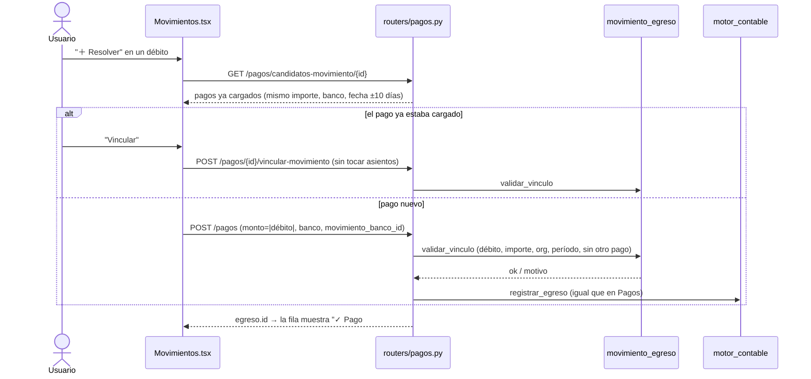

# Business Rules — Cuadra

> **Documento más crítico del set**: las reglas de negocio **reales**, extraídas
> del código con cita a `archivo:línea`. Si una regla acá no cita código, es un
> error. La óptica de producto está en [`PRODUCT_BIBLE.md`](./PRODUCT_BIBLE.md);
> los flujos en [`WORKFLOWS.md`](./WORKFLOWS.md).
>
> Antes de tocar fechas, montos (`Decimal`) o detección de banco, consultá
> también [`../../BUGS.md`](../../BUGS.md).

---

## 1. Motor de conciliación

Archivo: `backend/app/services/conciliacion.py`.

### 1.1. Scoring por identidad

El score lo calcula `_score_identidad()`
(`conciliacion.py:138-232`). Cada señal otorga un **puntaje base**; encima se
suma el **bonus por fecha** (§1.2). Las señales son **excluyentes y ordenadas**
(la primera que matchea retorna; el titular es fallback que acumula):

| Señal de identidad | Puntos base | Cita |
|---|---|---|
| CUIT exacto (10-11 dígitos) | **12** | `conciliacion.py:174-176` |
| CUIT de planilla como substring de dígitos del movimiento | **12** | `conciliacion.py:180-184` |
| CBU/CVU exacto (22 dígitos) | **10** | `conciliacion.py:188-189` |
| DNI de planilla (7-8 dígitos) embebido en el CUIT/CUIL del movimiento | **9** | `conciliacion.py:138-146` |
| Número en común de longitud ≥ 22 (CBU/CVU por longitud) | **10** | `conciliacion.py:198-199` |
| Número de cuenta largo (≥ 10 dígitos) en común | **8** | `conciliacion.py:200-201` |
| Número de referencia/operación (6-9 dígitos) en común | **6** | `conciliacion.py:202-203` |
| Titular: 2 palabras en orden exacto | **5** | `conciliacion.py:214-217` |
| Titular: 2 palabras presentes en distinto orden | **4** | `conciliacion.py:218-220` |
| Titular: solo primera palabra | **3** | `conciliacion.py:221-224` |
| Titular: única palabra presente | **3** | `conciliacion.py:225-227` |

Notas fieles al código:
- El caso DNI-embebido-en-CUIT (ago 2026, caso real de un cliente) cubre planillas
  que solo anotan el DNI del titular (8 dígitos) en vez del CUIT/CUIL completo
  (11). Como el CUIT argentino es 2 dígitos de tipo + DNI + 1 verificador, el DNI
  aparece como substring contigua dentro de los dígitos del movimiento. Antes de
  este fix, ese caso puntuaba 0 (ni el chequeo de CUIT-substring, que solo corre
  con `cuit_plan` de 10-11 dígitos, ni el cruce de números, que exige match
  exacto de todo el token) — la fila quedaba en "no coincide" pese a tener
  identidad suficiente para desempatar sin ambigüedad.
- Solo se consideran "palabras" de titular las **alfabéticas de ≥ 3 caracteres**
  (`conciliacion.py:212`), para no filtrar nombres cortos (Ana, Leo, Sol).
- Los números significativos que se cruzan son los de **6 a 22 dígitos**
  (`extraer_todos_numeros`, `conciliacion.py:54`).
- El umbral base `UMBRAL_BASE = 3` está definido (`conciliacion.py:16`) pero la
  lógica vigente usa "monto único vs repetido" (§1.4), no este umbral.

> ⚠️ La tabla de [`../../CLAUDE.md`](../../CLAUDE.md) y la del
> [`../../README.md`](../../README.md) muestran "titular 2 palabras = 5 / 1
> palabra = 3". El código tiene **más granularidad**: 5 / 4 / 3 según orden y
> presencia. Ver "Pendiente de revisar".

### 1.2. Bonus por fecha cercana

`_bonus_fecha()` (`conciliacion.py:110-135`), progresivo, **solo desempata**
(nunca descarta un match por identidad fuerte):

| Distancia | Bonus | Cita |
|---|---|---|
| 0 días (mismo día) | **+5** | `conciliacion.py:127-128` |
| 1-2 días | **+4** | `conciliacion.py:129-130` |
| 3-4 días | **+3** | `conciliacion.py:131-132` |
| 5-7 días | **+2** | `conciliacion.py:133-134` |
| 8-10 días | **+1** | `conciliacion.py:135` |
| > `dias_tolerancia` | **0** | `conciliacion.py:125-126` |

El bonus se aplica **solo dentro de la tolerancia** (`delta > dias_tolerancia`
→ 0). La **tolerancia de fecha por defecto** es **5 días**
(`CONFIG_DEFAULT_ORG["dias_tolerancia_fecha"] = 5`, `conciliacion.py:364`),
configurable por organización vía `dias_tolerancia_fecha`
(`conciliacion.py:272`).

> El comentario del código (`conciliacion.py:118-119`) lista los tramos hasta
> "8-10 días → +1", pero el bonus solo se aplica si la distancia ≤
> `dias_tolerancia`. Con el default de 5 días, los tramos +1 (8-10) y parte de
> +2 (6-7) nunca se alcanzan. Ver "Pendiente de revisar".

### 1.3. Tolerancia de monto

`montos_iguales()` compara con tolerancia **0.01** por defecto
(`conciliacion.py:100-101`); configurable por org vía `tolerancia_monto`
(`conciliacion.py:271`, default `0.01` en `conciliacion.py:362`).

### 1.4. Regla fundamental: monto duplicado → exigir identidad

En `buscar_match()` (`conciliacion.py:255-357`):

- **Monto único** en el extracto (1 solo candidato): se acredita directo, sin
  exigir identidad — no hay ambigüedad (`conciliacion.py:311-312`).
- **Monto repetido** (≥ 2 candidatos del mismo monto): **SIEMPRE** se exige
  identidad vía scoring (`conciliacion.py:314-350`). Razón documentada en el
  código: en un extracto real puede haber 30 movimientos de $50.000 el mismo día
  de clientes distintos (`conciliacion.py:305-310`).
- **Empate de score bajo** entre candidatos (dos con el mismo score y < 5): no
  se arriesga → estado `"ambiguo (N candidatos, mismo score)"`
  (`conciliacion.py:343-348`).

### 1.5. Estados de fila (resultado de la conciliación)

Estados base que produce el motor (`buscar_match` + `conciliar_planilla`):

| Estado | Significado | Cita |
|---|---|---|
| `ok` | Acreditado contra un movimiento | `conciliacion.py:278`, `312`, `350` |
| `no está` | Ningún movimiento con ese monto | `conciliacion.py:284` |
| `duplicado` | La misma fila aparece dos veces en esta corrida y todos los candidatos ya se usaron | `conciliacion.py:296-298` |
| `acreditado DD/MM` | El movimiento ya fue acreditado en una corrida anterior | `conciliacion.py:301-303` |
| `faltan datos` | El monto de la fila no se pudo parsear | `conciliacion.py:413-414` |
| `ambiguo (N candidatos, mismo score)` | Empate de score bajo | `conciliacion.py:348` |
| `sin datos (N mov. …)` | Monto repetido sin ningún identificador | `conciliacion.py:356` |
| `no coincide (N mov. …)` | Hay identificadores pero ninguno matchea | `conciliacion.py:357` |
| `ok` (vía aprendizaje) | Resuelto por patrón aprendido — internamente `"ok (aprendido)"` y luego se guarda como `ok` | `conciliacion.py:452-464` |
| `SUGERIDO_GRUPO` | El motor propone conciliarla junto con otras filas o movimientos (grupo); la confirma una persona | §1.10 |

**Estados ricos** (opt-in por org, lista en `models/planilla.py:10`
`ESTADOS_RICOS = ["PAGO_PARCIAL", "CONCILIADO_CON_DIFERENCIA", "VENCIDO", "EN_REVISION"]`):

- `EN_REVISION`: si la org habilita el estado, los que serían "faltan datos"/no
  resueltos pasan a cola de revisión en lugar de fallar
  (`conciliacion.py:458-462`).
- `PAGO_PARCIAL`, `CONCILIADO_CON_DIFERENCIA`, `VENCIDO`: se asignan al
  **resolver manualmente** una fila `EN_REVISION` (`resolver_revision`,
  `routers/planillas.py:334-350`). Requiere que la org tenga
  `requiere_cierre_periodo=true` (`routers/planillas.py:315-319`).

> El monto duplicado y el monto ya acreditado se contabilizan ambos como
> `duplicadas` en el resumen (`conciliacion.py:485-486`).

### 1.5bis. Resolución manual de filas ambiguas

Cuando el scoring automático no puede desempatar (`no coincide`, `ambiguo`,
`sin datos`), hay **dos** caminos manuales distintos según el caso — no son
intercambiables:

| Caso | Dónde | Qué hace | Endpoint |
|---|---|---|---|
| La fila **ya existe** en una planilla del cliente y solo falta elegir cuál de los movimientos candidatos es | Botón "🔗" en la fila (Historial/PlanillaPanel) | Resuelve **esa fila en su lugar**: `status="ok"`, linkea `orden_movimiento_acreditado`, sincroniza `mov.cliente_acreditado` y dispara `registrar_reclasificacion_planilla` — mismo criterio que "Re-conciliar". No crea filas nuevas. | `GET /planillas/rows/{id}/candidatos-movimiento`, `POST /planillas/rows/{id}/asignar-movimiento` (`routers/planillas.py`) |
| El movimiento es realmente **huérfano** — plata que llegó al banco sin que el cliente la declarara en ninguna planilla | Vista Movimientos (extracto) → "acreditar a cliente" | Marca `mov.cliente_acreditado` y agrega una fila a la planilla original del cliente para ese extracto (o crea una planilla "acreditación manual {d}.{m}" si no existe ninguna) | `POST /clientes/movimientos/{mov_id}/acreditar` (`routers/clientes_dir.py:429-559`) |

> **Regresión ago 2026 (caso real de un cliente):** antes solo existía el segundo
> camino. Usarlo para resolver una fila ya existente (monto duplicado
> ambiguo) dejaba la fila original huérfana en "no coincide" para siempre y
> agregaba una fila nueva — funcionaba para el total de la cuenta corriente,
> pero era confuso y no reflejaba qué pasó. El botón "🔗" cubre ese caso
> correctamente.

### 1.6. Configuración por organización

`CONFIG_DEFAULT_ORG` (`conciliacion.py:361-367`) — comportamiento de la org base:
```python
{
  "match_rules": ["monto_cuit"],
  "tolerancia_monto": 0.01,
  "dias_tolerancia_fecha": 5,
  "estados_habilitados": ["pendiente","ok","no está","duplicado","faltan datos"],
  "requiere_cierre_periodo": False,
}
```
- `auto_confirmar_grupos` (opcional, default `false`): si es `true`, un grupo (§1.10) único y con
  el CUIT del movimiento en todas las filas se confirma solo; si no, queda sugerido.
- `match_rules` con `"referencia"` habilita el match por referencia exacta antes
  del scoring (`conciliacion.py:275-278`, `buscar_match_referencia`
  `conciliacion.py:235-252`).
- Un movimiento solo es candidato si es **libre** (`es_libre()`:
  `cliente_acreditado` es None, vacío o "no identificado" —
  `conciliacion.py:104-107`) o ya pertenece al mismo cliente
  (`conciliacion.py:288-292`).

### 1.7. Bloqueo de planillas duplicadas (por cliente) — desde ago 2026

Archivo: `backend/app/routers/planillas.py` (`upload_planilla`), migración 026.

- `POST /planillas/upload` calcula `fingerprint = sha1(contenido_del_archivo)` y
  rechaza con **409** si ya existe una planilla **activa** (no borrada) con el
  mismo `(cliente_id, fingerprint, organizacion_id)`. Mismo patrón que
  `ExtractoBancario.fingerprint` (§ arquitectura, índice único parcial
  `uq_extracto_fp_org`), acá `uq_planilla_fp_cliente_org` — `WHERE fingerprint
  IS NOT NULL AND deleted_at IS NULL`, así borrar la planilla existente libera
  el fingerprint para re-subir.
- El bloqueo es por **archivo idéntico para el mismo cliente**, no por cliente
  solo: dos clientes distintos pueden subir un archivo con bytes idénticos sin
  problema; el mismo cliente con datos distintos (mes siguiente) tampoco choca
  porque el contenido cambia.
- El mensaje de error incluye el id/fecha de la planilla existente y sugiere el
  camino correcto para el caso de uso real que motivó esto: si lo que cambió es
  el **% de comisión** (se tipea al conciliar, no viaja en el archivo — ver §4.1),
  no hace falta re-subir el archivo — hay que re-conciliar la planilla ya cargada
  con el % correcto.

---

### 1.8. Motivo del match y resumen del extracto (read-only) — desde oct 2026

Dos lecturas que **no participan de la decisión del motor** ni cambian ningún
status:

- **Motivo de cada match** — `explicar_match()` (`services/conciliacion.py`).
  Para cada fila `ok` de `/planillas/{id}/detalle` devuelve `motivo_match`: qué
  dato coincide hoy entre la fila y su movimiento, probando `_score_identidad`
  con UNA señal por vez y sin bonus de fecha (mismas reglas que §1.1, sin
  duplicarlas). Orden: `cuit` → `dni` → `cbu` → `numero` → `titular` →
  `referencia` → `monto` (solo coincide el importe). Describe la coincidencia,
  no cómo se decidió, así que vale igual para matches automáticos, aprendidos o
  manuales. La UI lo muestra bajo el estado ("Coincide: monto + CUIT"; "solo
  monto" en ámbar).
- **Resumen del extracto** — `GET /extractos/{id}/resumen`
  (`services/gastos_bancarios.py`):
  - `gastos_bancarios`: solo **débitos** (monto < 0) agrupados por concepto con
    regex sobre el texto del movimiento, primera regla que matchea gana:
    Impuesto Ley 25.413 → SIRCREB / Ingresos Brutos → Percepción IVA → IVA →
    Comisiones y mantenimiento → Intereses y sellos. Total en positivo, Decimal.
    Un crédito nunca es gasto (un cliente "IVA SRL" no cuenta).
  - `explicado`: créditos (monto > 0) del extracto con cliente acreditado
    (`es_libre()` falso) sobre el total de créditos; `porcentaje` None si no hay
    créditos.
  - `debitos` (v3.32): débitos (monto < 0) **explicados** — por un gasto bancario
    reconocido (regla de arriba) o por un pago vinculado (§1.9) — sobre el total
    de débitos, más `total_sin_explicar` en positivo. Un débito que es gasto
    bancario y además tiene pago cuenta una sola vez.

### 1.9. Resolver un débito pendiente con un pago vinculado — v3.32

Desde Movimientos, un débito sin explicar se resuelve registrando el pago o
gasto que lo explica ("＋ Resolver"), sin ir a Pagos. El vínculo es
`Egreso.movimiento_banco_id` (`services/movimiento_egreso.py`):

- Tres tipos, como en Pagos: **gasto propio** y **pago a un proveedor propio** (van a Gastos de
  la organización) u **OP por cuenta de un cliente** (`pago_cliente`: la organización paga a un
  proveedor del cliente y se debita la **cuenta corriente del cliente**; no es gasto ni proveedor
  de la organización). Organización ≠ cliente: ver CLAUDE.md → Multi-tenant.
- Solo **débitos** y egresos con `forma_pago=banco`. Un crédito se sigue
  explicando acreditándolo a un cliente (`cliente_acreditado`), que no se toca
  para los débitos porque alimenta reportes y cuentas corrientes de clientes.
- **Mismo importe** al centavo (Decimal): |monto del movimiento| = monto del egreso.
- **Un pago por movimiento**; misma organización; extracto no borrado; período
  no cerrado.
- `POST /pagos` acepta `movimiento_banco_id`; `PATCH /pagos/{id}` lo vincula
  (id) o desvincula (`null`). Mientras siga vinculado, editar el monto o la forma
  de pago a algo que no coincida se rechaza (400).
- **Pago ya cargado**: si el pago se registró antes en Pagos, no hay que crear
  otro (duplicaría el gasto y el asiento). `GET /pagos/candidatos-movimiento/{id}`
  sugiere los pagos de la org con el mismo importe, banco, sin vincular y fecha a
  ±10 días (`DIAS_CANDIDATOS`), el más cercano primero; el modal los muestra
  arriba. `POST /pagos/{id}/vincular-movimiento` guarda solo el vínculo, **sin
  reversar ni rehacer el asiento** (el PATCH sí los rehace).
- **Contabilidad**: el egreso genera el mismo asiento que cargado a mano en Pagos
  (`registrar_egreso`): Gasto (o Cliente, si es OP por cuenta de un cliente) D /
  **Pagos a imputar 2-1-1-2** H. El débito del extracto ya registró 2-1-1-2 D /
  Banco H, así que la transitoria queda en cero y el banco se movió una sola vez
  (modelo de cuentas transitorias, oct 2026 — ver
  [ACCOUNTING_ENGINE](../architecture/ACCOUNTING_ENGINE.md) §2bis). Borrar el
  movimiento deja el pago sin vínculo; borrar el pago libera el movimiento.



### 1.10. Conciliación en grupos — un movimiento contra varias filas (oct 2026)

Archivos: `backend/app/services/conciliacion_grupos.py`, `models/conciliacion_grupo.py`,
`routers/planillas.py` (endpoints de grupos), `frontend/src/components/AgruparModal.tsx`.
Migración 039.

El 1:1 (§1.1–1.5) exige una fila y un movimiento del **mismo monto**. Dos casos reales no entran:

- **A — un movimiento ↔ varias filas**: el cliente pagó varias filas de su planilla con una sola
  transferencia.
- **B — varios movimientos ↔ una fila**: pagó una fila en dos o más transferencias.

**Modelo.** `conciliacion_grupos` (cabecera: planilla, estado, origen auto/manual, totales,
diferencia, `ambiguo`) + `conciliacion_grupo_items` (un item por fila o por movimiento, con su
monto). El 1:1 sigue en `PlanillaRow.orden_movimiento_acreditado`, sin cambios; las filas de un
grupo dejan ese campo en **NULL** a propósito (liquidaciones suma `mov.monto` por fila y la
reclasificación suma filas `ok` con movimiento: con el campo lleno, un movimiento de un grupo A se
contaría N veces). Una fila está a lo sumo en un grupo activo; un movimiento también.

**Estados del grupo**: `sugerido` (lo encontró el motor; filas en `SUGERIDO_GRUPO`, el movimiento
**no** se acredita) → `confirmado` (filas en `ok`, o `CONCILIADO_CON_DIFERENCIA` si no cuadra;
movimientos con `cliente_acreditado`) → `descartado` (sugerencia descartada o grupo deshecho; se
guarda para no volver a sugerir esa misma combinación y por trazabilidad).

**Sugerencias automáticas** (`sugerir_grupos`, al final de `conciliar_planilla`, después de la
pasada 1:1 y solo sobre lo que quedó libre):

- Filas candidatas: de la **misma planilla**, sin movimiento, sin grupo, monto > 0 y en un estado
  "sin conciliar" (`no está`, `no coincide…`, `ambiguo…`, `sin datos…`, `pendiente`,
  `EN_REVISION`). Movimientos candidatos: créditos libres (`es_libre`), no usados en la corrida, en
  ningún grupo activo.
- **Apoyo** por par fila↔movimiento: identidad (mismo `_score_identidad` del 1:1, sin bonus de
  fecha: CUIT, DNI, CBU, números, titular) o fecha cercana. Ventana = `max(dias_tolerancia_fecha,
  5)` días; si las dos fechas existen y están fuera de la ventana, **no** es candidato aunque
  coincida la identidad. Sin identidad ni fechas → no es candidato.
- **Búsqueda acotada** (subset-sum con poda por suma restante): 2 a **6** items por grupo, los
  **20** candidatos de más apoyo por objetivo, hasta 10 combinaciones por objetivo y un
  presupuesto de **200.000** nodos por corrida. Suma cuadra = `|suma − objetivo| <` tolerancia de
  la org (igual que `montos_iguales`), en Decimal.
- Primero A (por movimiento, en orden de fecha), después B (por fila). Lo que entra en un grupo ya
  no participa de otro.
- **Ambigüedad**: si hay una sola combinación (y la búsqueda no se cortó), es única. Si hay
  varias, se sugiere la de más apoyo marcada `ambiguo` ("hay otra combinación posible"); si las dos
  mejores empatan, **no se sugiere nada** (no se adivina).
- **Auto-confirmación** solo si la org tiene `auto_confirmar_grupos: true` (default **false** =
  solo sugerir), la combinación es **única** y **todas** las filas comparten el CUIT del movimiento
  (B: todos los movimientos traen el CUIT de la fila). Un grupo ambiguo nunca se confirma solo.
- Re-conciliar borra y recalcula los grupos `sugerido`; los `confirmado` se respetan como una
  decisión manual (sus filas no se re-matchean y sus movimientos no se reusan); una combinación
  `descartado` no se vuelve a sugerir.

**Manual** (`PlanillaPanel` → seleccionar filas → "Agrupar"): varias filas contra **un**
movimiento, o **una** fila contra varios; 1 contra 1 se resuelve con "Asignar movimiento" (🔗,
§1.5bis). El modal lista los créditos libres del extracto de la planilla
(`GET /planillas/{id}/movimientos-libres`) y muestra el subtotal en vivo: verde si cuadra, rojo con
la diferencia (movimientos − filas) si no. Con diferencia solo se confirma marcando "conciliar
igual" → filas `CONCILIADO_CON_DIFERENCIA` (mismo estado rico de §1.5).

| Acción | Endpoint | Permiso |
|---|---|---|
| Movimientos libres para agrupar | `GET /planillas/{id}/movimientos-libres` | autenticado (org) |
| Armar y confirmar a mano | `POST /planillas/{id}/grupos` `{row_ids, movimiento_ids, con_diferencia}` | `reconcile` |
| Confirmar una sugerencia | `POST /planillas/grupos/{id}/confirmar` | `reconcile` |
| Deshacer / descartar | `POST /planillas/grupos/{id}/deshacer` | `reconcile` |

- Validaciones (400/404/409): forma del grupo, filas de la misma planilla y sin conciliar,
  movimientos del extracto de la planilla y de la misma org, créditos libres, fuera de otros grupos
  y sin fila 1:1; período cerrado → 409. Todo queda en auditoría (`CREAR_GRUPO_MANUAL`,
  `CONFIRMAR_GRUPO`, `DESHACER_GRUPO`).
- Una fila en un grupo no se edita suelta: `PATCH /rows/{id}`, `DELETE /rows/{id}` y
  `asignar-movimiento` devuelven 409 ("confirmalo o deshacelo primero").
- Deshacer: filas a `pendiente`, movimientos liberados (solo si seguían acreditados a este
  cliente), grupo `descartado`.
- `GET /planillas/{id}/detalle` devuelve en cada fila `grupo` (estado, totales, diferencia,
  `ambiguo`, movimientos) y los contadores `sugeridas_grupo` / `con_diferencia`;
  `POST /conciliar` devuelve `grupos_sugeridos` / `grupos_confirmados`.
- Contabilidad: ver §4.1bis y [ACCOUNTING_ENGINE](../architecture/ACCOUNTING_ENGINE.md) §5.

### 1.11. Calidad del match ("coincidencia") — oct 2026

Caso real: una fila con CUIT 20123456786 quedó `ok` contra un movimiento cuyo texto trae CUIT
20123456794 — otro CUIT, cerró solo porque el monto era único (§1.4). Para que se vea sin cambiar
ninguna decisión del motor, `coincidencia_match()` (`services/conciliacion.py`, read-only)
calcula para cada fila conciliada (`ok`, `CONCILIADO_CON_DIFERENCIA`, `SUGERIDO_GRUPO`):

| Valor | Cuándo |
|---|---|
| `cuit` | el CUIT de la fila está en el texto del movimiento |
| `cuit_distinto` | los dos traen CUIT (11 dígitos, con o sin guiones) y no coinciden. Gana sobre todo lo demás |
| `titular` | coincide el nombre |
| `otro_dato` | coincide DNI, CBU/CVU, n° de cuenta/operación o referencia |
| `solo_monto` | no coincide ningún dato, solo el importe |

En un grupo se compara la fila contra todos sus movimientos: si alguno trae otro CUIT, gana
`cuit_distinto`. Se expone en `/planillas/{id}/detalle` (`coincidencia`) y en el dict de filas que
recibe `export_planilla_conciliada` / el PDF (claves `coincidencia` y `grupo_id`; el layout del
export no cambia). La UI muestra un aviso: "⚠ CUIT distinto" (rojo) y "⚠ Solo monto" (ámbar).

## 2. Deduplicación de Últimos Movimientos (UM)

Archivo: `backend/app/services/extracto_merger.py`,
función `_match_existente()` (`extracto_merger.py:37-55`).

Un movimiento del UM se considera **duplicado** de uno existente si:

1. **(saldo, monto) coinciden** (ambos con tolerancia 0.01) —
   `extracto_merger.py:45-49`; **o**
2. **(fecha_iso, monto, titular_normalizado) coinciden** —
   `extracto_merger.py:50-54`.

`titular_normalizado` = quita CUITs (10-11 dígitos), pasa a minúsculas y toma las
**primeras 3 palabras de > 2 caracteres** (`_normalizar_titular`,
`extracto_merger.py:21-27`).

Estrategia de corte para saber dónde termina lo ya cargado (en orden de
prioridad, `extracto_merger.py:96-155`):
1. **Manual** (`corte_saldo`): busca ese saldo exacto en el UM.
2. **Ancla**: el movimiento de mayor `orden` del extracto; matchea por
   saldo + monto + fecha + titular (cuantos más campos coincidan, mejor score).
3. **Fallback**: primer movimiento del UM que ya exista.

Solo se agregan los movimientos **anteriores al corte** (`extracto_merger.py:158`)
y, como red de seguridad, se descartan los que ya existen
(`extracto_merger.py:161`). Los nuevos se marcan `source='um'` con un `um_lote`
incremental (`extracto_merger.py:184-188`).

### 2ter. Importar extractos Excel/CSV de cualquier banco (oct 2026)

Archivos: `backend/app/services/extracto_mapper.py` (lectura, puro),
`extracto_plantillas.py` (plantillas por org), `routers/extractos.py` (`/preview`, `/upload`,
`/agregar-um`), frontend `components/extractos/ExtractoMapperModal.tsx` + `Dashboard.tsx`.

Formatos: `.xlsx` (con `data_only=True`: una columna con fórmulas trae el último valor calculado),
`.xls`, `.csv`, `.tsv`, `.txt` (separador `;` `,` tabulador o `|`, detectado solo; UTF-8 o Latin-1).

Qué columna es cada cosa, en este orden:
1. **Mapeo confirmado por la persona** (form `mapeo` en `/upload`, `/agregar-um` y `/preview`).
2. **Plantilla guardada de la organización** (`plantillas_extracto_excel`): clave = huella del
   renglón de títulos normalizado + banco detectado (`firma_encabezado`). Se busca en las primeras
   30 filas de cada hoja, así que la plantilla sigue sirviendo si el título se corre unas filas.
3. **Detección automática**: palabras clave del encabezado (`excel_parser.rol_por_encabezado`,
   única fuente) validadas con el contenido de hasta 20 filas siguientes (≥ 60 % de las celdas
   tienen que ser importes / fechas). Una columna con título conocido y contenido de otro tipo se
   descarta (y se avisa).
4. **Sugerencia por contenido** cuando no hay títulos reconocibles: propone fecha, importe, saldo y
   detalle, pero **nunca se importa sin confirmación** (`/upload` sin mapeo responde 422
   `{codigo: "necesita_mapeo"}`). **Ya no se asumen en silencio las columnas de Banco Macro.**

Roles: fecha, titular (detalle), monto, débito, crédito, indicador (D/C), saldo, orden/referencia,
CUIT (se agrega al texto del titular porque el motor busca el CUIT ahí), mes, cliente acreditado,
fecha de acreditación. Convención de signo: una columna con signo / columnas Débito y Crédito
(crédito − débito) / importe + columna que dice débito o crédito.

Lectura de celdas (Decimal punta a punta, `decimal_utils.parse_importe_ar`): `1.234,56`,
`-1.234,56`, `1.234,56-`, `(1.234,56)`, `$ 1.234,56`, `1,234.56`; separador decimal detectado por
columna o forzado en el mapeo. Fechas: `dd/mm/aaaa`, `d/m/aaaa`, `dd/mm/aa`, `aaaa-mm-dd`,
`aaaammdd`, número de serie de Excel, `19-may-26`, con o sin hora; `mm/dd/aaaa` si la columna lo
delata (algún "día" > 12 en el segundo lugar) o si se elige en el mapeo.

Filas que no son movimientos: vacías; de **total o saldo** ("TOTAL", "Subtotal", "Saldo anterior",
"Saldo final", "Transporte"…) **sin fecha o sin importe** — una empresa "TOTAL ENERGIES" con fecha e
importe sí es un movimiento —; sin importe; con columna de fecha pero fecha ilegible (se cuentan y
se avisa). "Saldo anterior/inicial" y "Saldo final/al" aportan el saldo de apertura/cierre.

**Control de saldos** (misma regla que el PDF, `extracto_pdf.saldos.validar_saldos`):
saldo anterior + importe = saldo, fila por fila, más apertura + créditos − débitos = cierre. El
sentido del archivo (más viejo primero o más nuevo primero, como Macro) se detecta solo: se prueban
los dos y gana el que corta menos veces el saldo corrido; si empatan, las fechas y después el orden.
Se informa la **primera fila (en orden cronológico) donde no cuadra**, con su número de fila de Excel.
Si el saldo no encadena en ningún sentido y las fechas dicen otro, mandan las fechas.

**Sentido normalizado al importar**: `parsear_extracto_bancario` entrega siempre los movimientos
**del más nuevo al más viejo** (como Macro), que es lo que esperan la numeración de `orden` de
`crear_extracto_con_movimientos`, el corte del merge de UM y la huella. Un archivo "del más viejo
al más nuevo" se da vuelta; así un banco ascendente se comporta igual que Macro (mismo `orden`,
UM que agrega solo lo nuevo, re-subida reconocida como duplicada). Si el sentido no se puede
detectar (sin saldo y con todas las fechas y órdenes iguales, `orden_detectado = false`) se
deja el orden del archivo. La pantalla de columnas muestra la muestra en el orden del archivo.

Cuándo se muestra la pantalla de columnas (`necesita_mapeo`): sin detección o solo sugerencia, 0
movimientos, saldos que no cuadran **sin plantilla guardada**, o detección automática con confianza
< 0,8 (p. ej. sin columna de fecha). Con plantilla guardada o detección segura → un clic, como antes.

**Saldos que no cuadran con plantilla guardada**: no frena la carga (suele ser un archivo al que le
faltan movimientos). Se importa y queda un aviso no bloqueante "Los saldos no cuadran desde la fila
N: puede que falten movimientos en este archivo" en `extractos_bancarios.aviso_saldos` (migración
038): lo devuelven `/upload` y el listado `GET /extractos`, y el Dashboard lo muestra en un cartel
ámbar al subir y debajo del extracto seleccionado. Re-subir el mismo archivo actualiza el aviso.
Al importar con un mapeo confirmado se guarda/actualiza la plantilla (auditoría
`plantillas_extracto_excel`); cuando una plantilla se aplica sola suma un uso. Las plantillas son
de cada organización (aislamiento por `organizacion_id`).

Nota: la huella (`extracto_import.fingerprint`) suma los importes en float a propósito, para que
siga dando igual que cuando el parser devolvía float (re-subir un extracto ya cargado lo reconoce).

**Qué banco es** (oct 2026, `services/banco_identificacion.py`, la misma regla para Excel/CSV y PDF).
Señales, de la más fuerte a la más débil:
1. **CBU/CVU de la cuenta** en el encabezado (filas de arriba de la tabla), las propiedades del
   libro (título, asunto, descripción) o el **nombre del archivo**. Se valida con los dos dígitos
   verificadores (BCRA) y los 3 primeros dígitos son el código de entidad del BCRA
   (`BANCOS_POR_CODIGO`, fuente: Com. "A" 8367 del 12/12/2025). Un CVU que empieza con `0000003`
   es Mercado Pago. Motivo: "por el CBU de la cuenta" / "por el CVU de la cuenta".
2. **CUIT del banco** en el encabezado (`CUIT_BANCOS`, verificados contra el BCRA).
3. **Formato del archivo**: títulos de columnas y conceptos típicos (`ENCABEZADOS_TIPICOS`,
   `CONCEPTOS_TIPICOS`; hoy Macro — Orden/Fecha/Mes/Titular/Importe/Saldo o 2+ conceptos
   "ING TRANSF:" — y Mercado Pago por las columnas del reporte de liberaciones).
4. **Archivo igual ya subido**: el banco guardado en la plantilla de ese formato.
5. **Nombre** en el encabezado (el detector de siempre, ahora solo sobre el membrete y los
   títulos, no sobre los movimientos) o en el nombre del archivo. Nunca le gana a un CBU.

**Confirmado antes**: si la persona eligió el banco en la pantalla (lo cambió, o el sistema no
estaba seguro), se guarda en la plantilla (`banco_clave` + `mapeo.banco_confirmado`, sin columna
nueva) y la próxima vez **le gana a todo**, avisando si el archivo dice otra cosa. Aceptar un banco
que salió con seguridad (CBU) no crea plantilla. Es por organización.

Resultado `banco_deteccion` en `/preview`: `{banco_clave, nombre, confianza, motivo, origen,
conflicto, pedir_confirmacion}`. Si las señales no coinciden gana la más fuerte y `conflicto` lo
dice; sin nada → "generico", confianza 0 y la pantalla pide elegirlo. El Dashboard abre la pantalla
de columnas también cuando `pedir_confirmacion` (y no se escribió un banco a mano arriba), con
"Banco detectado: X (motivo)" y un desplegable (`GET /extractos/bancos`). `/upload` acepta
`banco_clave` (form): manda sobre lo detectado; "generico" guarda "Otro banco" (o el nombre escrito
a mano), nunca el "Banco Macro" por defecto. Las CBU/CUIT de los conceptos de los movimientos no
cuentan (son de terceros).

La **firma** de plantillas y moldes sigue usando el banco por nombre de siempre
(`detectar_banco_filas` / `extracto_pdf.bancos`): así los formatos ya guardados se siguen
reconociendo.

### 2bis. Extractos en PDF (v3.31)

Detalle completo en [EXTRACTOS_PDF.md](./EXTRACTOS_PDF.md). Lo que toca a estas reglas:
- Un PDF que se pisa con un extracto existente se agrega con **este mismo merge** de UM
  (`source='um'`, `um_lote`, asiento automático): no hay una segunda lógica de deduplicación.
  Un PDF guardado como extracto nuevo genera el asiento del extracto principal igual que el
  Excel (uno por día, `extracto_banco`).
- Antes de guardar, el PDF se valida con `saldo inicial + créditos − débitos = saldo final`
  (Decimal, tolerancia $0,01) y el saldo corrido fila por fila; si no cierra, solo se guarda con
  confirmación explícita.
- Para decidir si el PDF ya está cargado se compara por **fecha e importe** contra extractos
  activos o archivados cuyas fechas se pisan (no solo por la huella cantidad + suma).

---

## 3. IA Nivel 2 — aprendizaje de correcciones

Archivos: `backend/app/services/aprendizaje.py` + modelo
`backend/app/models/patron_aprendido.py` (`PatronAprendido`).

- **Registro** (`registrar_correccion`, `aprendizaje.py:38-92`): cuando el
  usuario corrige una fila a `ok`, se extrae el patrón (fragmento de titular del
  extracto + números clave) y se guarda/refuerza. Cada confirmación incrementa
  `veces_visto` y `veces_correcto` (`aprendizaje.py:73-75`).
- **Aplicación automática** (`buscar_por_patrones`, `aprendizaje.py:95-150`):
  antes de declarar fallo, se consultan los patrones del cliente/org que estén
  **activos y con `veces_correcto >= 2`** (`aprendizaje.py:116-121`). Es decir:
  **2+ confirmaciones → el patrón se aplica solo**. El match se da por fragmento
  de titular del extracto (`aprendizaje.py:139`) o por números en común
  (`aprendizaje.py:143-148`).
- Integración en el motor: se llama **después** del scoring, solo si el estado no
  es `ok`/`no está`/`duplicado`/`acreditado` (`conciliacion.py:434-456`).

> **Bug corregido (Fase 2)**: en `aprendizaje.py` la rama "match por números del
> plan" referenciaba `nums_plan` (indefinido) en vez de `numeros_plan` → `NameError`
> en runtime. Corregido + test de regresión en `tests/test_aprendizaje.py`.

---

## 4. Comisiones

### 4.1. Comisión por planilla / cliente (liquidaciones)

Archivo: `backend/app/routers/liquidaciones.py`.

- El porcentaje se toma con esta **prioridad** (`_calcular_monto_y_comision`,
  `liquidaciones.py:47-111`): **% propio de la planilla** (`Planilla.porcentaje_comision`)
  → si es None, **% fallback del formulario** → si no hay, **0%**
  (`liquidaciones.py:100-104`). Comentario explícito: el % del cliente **no se
  hereda**; cada planilla debe tener el suyo (`liquidaciones.py:144-147`).
- `_comision_cliente()` (`liquidaciones.py:38-44`) lee de la config de org
  `comisiones.por_cliente[cliente]` y, si no está, `comisiones.porcentaje_default`
  (default **1.5**). *(Helper presente; el cálculo principal usa la prioridad de
  arriba.)*
- Solo entran filas con **`status == "ok"`** y `fecha_acred` (o, si es None, la
  fecha de carga de la planilla) **dentro del período**
  (`liquidaciones.py:69-82`).
- El monto de cada fila se toma del **movimiento bancario acreditado** si existe;
  si no, del monto de la fila (`liquidaciones.py:93-98`).
- `comision = monto_fila * pct / 100`; `neto = monto - comisión`
  (`liquidaciones.py:106`, `167`).
- Solo cubre planillas (TT). **Los cheques se liquidan por separado** en su
  módulo (`liquidaciones.py:55`).

> **No hay doble cobro posible entre el % de la planilla y el % del cliente** —
> son dos números que ni siquiera se suman: son **campos independientes que
> alimentan pantallas distintas** y pueden mostrar valores diferentes para el
> mismo cliente/período si no coinciden:
> - **Liquidaciones** (arriba) usa exclusivamente `Planilla.porcentaje_comision`
>   (el % tipeado al conciliar esa planilla puntual). Nunca lee `Cliente.porcentaje_comision`.
> - **Estado de Cuenta** (`reportes_service.calcular_estado_cuenta_cliente`,
>   `reportes_service.py:737-745`) — incluida la página pública compartida
>   (`/p/:token`) — usa `Cliente.porcentaje_comision` si está seteado, si no el
>   default de la org (`comisiones.porcentaje_default`, 1.5%). Nunca lee
>   `Planilla.porcentaje_comision`.
>
> Si el % "de siempre" de un cliente está en su ficha (`Clientes.porcentaje_comision`,
> ej. 2%) y además se tipea un % al conciliar cada planilla, mantenerlos iguales es
> responsabilidad manual — el sistema no los sincroniza ni los valida entre sí.

### 4.1bis. Asiento contable al conciliar una planilla (cuenta corriente del cliente)

Archivos: `backend/app/services/conciliacion.py` (`conciliar_planilla`) +
`backend/app/services/motor_contable.py` (`registrar_reclasificacion_planilla`).
Tratamiento acordado con el contador (ago 2026).

Al conciliar filas de una planilla contra el banco, además de actualizar el
`status` de cada fila, se postea un asiento que reclasifica la plata del banco
a la cuenta corriente del cliente:

- **Cliente (Haber) = NETO** (total conciliado **menos** la comisión de esa
  planilla) — es lo que se ve como "Total Crédito" en Cuentas Corrientes.
- **Pagos al cliente** (efectivo/transferencia, eventos `pago_cliente_banco` /
  `pago_cliente_efectivo`) siguen siendo lo único que entra en "Total Débito".
  La comisión **no** pasa por el débito del cliente — se separa a un asiento
  distinto, no ensucia su cuenta corriente.
- **Comisión** → asiento aparte: **Comisiones ganadas** (3-1-1-0) al Haber, se
  reconoce como ingreso nuestro independiente de la cuenta del cliente.

**Contrapartida (Debe): siempre No identificado (2-1-1-1)** — cobros a imputar.
Desde el modelo de cuentas transitorias (oct 2026) el crédito del banco queda en
2-1-1-1 venga de donde venga, y la reclasificación lo cancela:
| Origen del movimiento (`MovimientoBanco.source`) | Asiento del banco | Reclasificación (módulo) |
|---|---|---|
| `"extracto"` (extracto bancario principal) | `extracto_banco`: Banco Macro D / 2-1-1-1 H (uno por día) | 2-1-1-1 D / Cliente H (`reclass_planilla_principal`) |
| `"um"` (Últimos Movimientos) | `um_lote`: Banco Macro D / 2-1-1-1 H | 2-1-1-1 D / Cliente H (`um_reclass_planilla`) |

Una planilla con filas conciliadas contra **ambos** orígenes sigue generando
**dos asientos principales independientes** (uno por origen) — cada uno neteando
su propia comisión proporcional —, por trazabilidad y para que el upsert de un
bucket no pise al otro. Hasta oct 2026 el origen extracto debitaba Pasivo
Corriente (2-1-0-0) en el módulo `reclass_planilla_extracto`; esos asientos viejos
no se tocan y se corrigen con `POST /contabilidad/corregir-asientos-banco`
(ver [ACCOUNTING_ENGINE](../architecture/ACCOUNTING_ENGINE.md) §7bis).

- El **% de comisión efectivo** es el que se manda en el request de conciliar
  si es `> 0`, o si no vino, el que ya tenía guardado `Planilla.porcentaje_comision`
  (re-conciliar sin re-tipear el % no lo pierde) — resuelto en el router
  (`planillas.py::conciliar`), no en `conciliar_planilla`.
- **Grupos (§1.10)**: un grupo confirmado es plata conciliada igual que un 1:1. Suma al bucket por
  el monto de **sus movimientos** (lo que entró al banco y quedó en 2-1-1-1; en un grupo con
  diferencia el cliente queda acreditado por lo recibido, no por lo declarado), y **cada
  movimiento va al bucket de su origen** — un grupo que mezcla extracto y UM reparte entre los dos
  asientos. Las filas 1:1 siguen sumando por el monto de la fila. Confirmar, armar o deshacer un
  grupo recalcula la reclasificación sin re-matchear (`recalcular_reclasificacion_planilla`); si
  un bucket queda en 0, su asiento vigente se borra (`anular_reclasificacion_planilla`, mismo
  criterio que la comisión que pasa a 0).
- **Upsert por `(modulo, planilla_id, organizacion_id)`**: re-conciliar
  recalcula sobre TODAS las filas `ok` (no solo las de esa pasada) y actualiza
  los asientos existentes — idempotente. Si el % de comisión baja a 0, el
  asiento de comisión se borra (no queda huérfano con un monto que ya no
  corresponde).
- La cuenta del cliente se resuelve/crea/vincula vía `_get_o_crear_cuenta_cliente`
  — **nunca** la cuenta madre genérica "Cliente" (2-1-2-0). Ese fue el bug de un
  backfill de arranque ya eliminado (ver CHANGELOG ago 2026): usaba la cuenta
  genérica y el monto bruto, dejando las cuentas corrientes por cliente vacías.

### 4.2. Comisión de cheques (local / interior)

Archivos: `backend/app/routers/cheques_common.py` y `cheques_crud.py`,
modelo `backend/app/models/cliente.py`.

- Clasificación por código postal: **CP < 2000 → "local"**, **CP ≥ 2000 →
  "interior"** (`_local_interior`, `cheques_common.py:100-104`).
- El % de comisión del cheque sale del cliente según la clasificación:
  `porcentaje_comision_local` (local) o `porcentaje_comision_interior` (interior)
  (`cheques_crud.py:195-198`). El cliente también tiene `porcentaje_comision`
  general (`models/cliente.py:12-14`).

---

## 5. Módulos de impuestos

Criterio común de **ingreso gravado** en los tres servicios de proyección:
cuentas de tipo `resultado` cuyo código empieza con **`3-1`**, sumando
`haber - debe` de sus líneas en el período
(IVA: `iva_service.py:105`; Monotributo: `monotributo_service.py:96-97`;
IIBB: `iibb_service.py:77-78`). Todos calculan con **`Decimal`**.

### 5.1. IVA — proyección y DDJJ

Archivo: `backend/app/services/iva_service.py`.

- **Es una proyección**, no un dato real: Cuadra no emite facturas, así que el
  débito fiscal se proyecta sobre los ingresos reconocidos
  (`iva_service.py:1-16`).
- **Débito fiscal**: ingresos (`HABER`) × `tasa_iva` de la cuenta
  (`iva_service.py:107-110`).
- **Crédito fiscal** = crédito **proyectado** (gastos gravados que reciben
  `DEBE` × tasa, `iva_service.py:111-114`) + crédito **real** ya contabilizado en
  la cuenta `1-1-2-4` (`iva_service.py:129-153`).
- **Saldo** = débito − crédito. Positivo = a pagar a ARCA; negativo = saldo a
  favor (`iva_service.py:158`).
- Se **excluyen** los asientos de módulo `tarjeta_liq` para no contar dos veces
  el crédito fiscal (`iva_service.py:89`).
- **Período**: `YYYY-MM` (mes calendario completo, `_rango_periodo`,
  `iva_service.py:46-56`).

### 5.2. Monotributo — control semestral

Archivo: `backend/app/services/monotributo_service.py`.

- **Herramienta interna de alerta**, no presenta DDJJ (`monotributo_service.py:1-8`).
- **Ventanas de cálculo** (últimos 12 meses al corte, `_rango_periodo`,
  `monotributo_service.py:47-73`):
  - `YYYY-S1` → corte **30/jun**, ventana `[1/jul/(YYYY-1), 30/jun/YYYY]`.
  - `YYYY-S2` → corte **31/dic**, ventana `[1/ene/YYYY, 31/dic/YYYY]`.
- **Categoría sugerida**: la de menor `orden` cuyo `limite_anual >=` ingresos 12m;
  si superan **todas**, devuelve la más alta y `excede=True`
  (`evaluar_categoria`, `monotributo_service.py:118-152`).
- Requiere `MonotributoConfig.activo = True`, si no lanza error
  (`monotributo_service.py:186-190`).
- Escala sembrada `_LIMITES_VIGENTES` (categorías A-K, vigente desde 1/ago/2026)
  — **editable, no hardcodeada en lógica**. El seed solo corre para orgs sin categorías; para las
  existentes, `actualizar_escala_sembrada` (en cada arranque) pasa a la escala vigente las filas
  que siguen con un valor exacto de `_ESCALAS_ANTERIORES`. Las editadas a mano se respetan y cada
  cambio se audita (`UPDATE_ESCALA_AUTO`, a nombre del primer superadmin).
  Recordatorio de actualización semestral en
  [`../../CLAUDE.md`](../../CLAUDE.md).

### 5.3. Ingresos Brutos (IIBB) y Convenio Multilateral

Archivo: `backend/app/services/iibb_service.py`.

- **Proyección interna**, no DDJJ oficial (`iibb_service.py:1-9`).
- **Modo `simple`**: ingreso total × alícuota de la jurisdicción única
  (`iibb_service.py:120-149`).
- **Modo `convenio_multilateral`**: el ingreso se reparte por el
  `coeficiente_distribucion` de cada jurisdicción activa y a cada porción se le
  aplica su propia alícuota (`iibb_service.py:151-180`). Si los coeficientes **no
  suman 100%** (tolerancia `0.0001`), **no se bloquea** pero devuelve un
  `warning` (`iibb_service.py:182-187`).
- Requiere `IIBBConfig.activo = True` (`iibb_service.py:105-109`).
- **Período**: `YYYY-MM` (`iibb_service.py:52-62`).

### 5.4. Inmutabilidad de snapshots presentados / revisados

Patrón compartido por los tres módulos en su `guardar_o_actualizar_*`:

| Módulo | Estado mutable (recalcula/pisa) | Estado inmutable (no se pisa) | Cita |
|---|---|---|---|
| IVA | `proyectado` | `presentado` | `iva_service.py:202-203` |
| IIBB | `proyectado` | `presentado` | `iibb_service.py:220-221` |
| Monotributo | `pendiente` | `revisado` | `monotributo_service.py:239-240` |

Una vez `presentado`/`revisado`, el upsert **devuelve el snapshot existente
intacto** (no recalcula ni sobreescribe). `marcar_presentada` / `marcar_revisado`
sellan el estado y registran la fecha (`iva_service.py:222-243`,
`iibb_service.py:239-262`, `monotributo_service.py:263-286`); exigen que el
snapshot ya exista (se calcula primero).

### 5.5. Comparar "Mis Comprobantes" de ARCA antes de importar — v3.33

Antes de importar el Excel de "Mis Comprobantes" (el que se descarga de la web
de ARCA; **no hay conexión con ARCA**), la pantalla de IVA lo compara con lo
cargado (`services/comparar_mis_comprobantes.py`, read-only):

- **Identidad** del comprobante: la del unique `uq_comprobante_iva_dedup` —
  (org, dirección, tipo, punto de venta, número, CUIT de la contraparte); el CUIT
  se compara solo por dígitos. `clave_comprobante()` = "tipo-pv-número-cuit".
- `POST /iva/comprobantes/comparar` devuelve:
  - `faltantes`: del período y no cargados, con su `clave`; `iva_faltante` suma
    su IVA (las notas de crédito restan).
  - `ya_cargados`: con `importe_distinto` si el IVA o el total no coinciden con
    lo cargado.
  - `solo_en_cuadra`: comprobantes del período que el Excel no trae (en compras:
    crédito fiscal en riesgo si el proveedor no lo informó).
  - `fuera_de_periodo`: cantidad; no se comparan.
- `POST /iva/comprobantes/importar` acepta `claves` (form, JSON) para importar
  solo las elegidas; sin `claves` importa todo como antes. Cada importación tiene
  un `lote` (uuid en `comprobantes_iva.lote_importacion`).
- `DELETE /iva/comprobantes/lote/{lote}` deshace la tanda (solo la org propia).
  **409** si la liquidación de IVA de alguno de sus períodos está `presentada`.

---

## 6. Cierre de período (inmutabilidad financiera)

Archivo: `backend/app/services/cierre_periodo.py`.

- Aplica solo si la org tiene `requiere_cierre_periodo=true` en su configuración
  (`_org_requiere_cierre`, `cierre_periodo.py:17-22`).
- `periodo_esta_cerrado()` devuelve True si la fecha cae dentro de un
  `CierrePeriodo` de la org (`cierre_periodo.py:24-46`). Los registros con fecha
  dentro de un período cerrado quedan **inmutables** (p. ej. `patch_row_status`
  valida el cierre antes de editar, `routers/planillas.py:387-389`).
- Al **generar una liquidación** no puede existir un cierre previo para ese
  período (`liquidaciones.py:135-142`).

---

## 7. Multi-tenant (regla transversal)

- **Organización A (`organizacion_id=1`)**: solo cambios aditivos, nunca se
  modifican sus datos existentes ([`../../CLAUDE.md`](../../CLAUDE.md)).
- Aislamiento por org en cada lectura/escritura. Detalle del modelo de permisos
  y roles en [`../security/SECURITY_MODEL.md`](../security/SECURITY_MODEL.md).

---

## Pendiente de revisar

1. **Granularidad del scoring de titular**: [`../../CLAUDE.md`](../../CLAUDE.md) y
   [`../../README.md`](../../README.md) documentan "2 palabras = 5 / 1 palabra =
   3". El código (`conciliacion.py:214-227`) distingue además **4 puntos** (2
   palabras presentes en distinto orden). La doc de alto nivel está incompleta,
   no incorrecta.
2. **Tramos de bonus de fecha vs. tolerancia**: con el default de 5 días, los
   tramos +1 (8-10 días) y +2 parcial (6-7 días) descritos en el comentario
   (`conciliacion.py:118-119`) son inalcanzables porque `_bonus_fecha` corta en
   `dias_tolerancia` (`conciliacion.py:125-126`). El comportamiento real depende
   del `dias_tolerancia_fecha` de cada org.
3. ~~**Bug en `aprendizaje.py:147`**: `nums_plan` indefinido~~ → **CORREGIDO** (Fase 2):
   ahora usa `numeros_plan`, con test en `tests/test_aprendizaje.py`.
4. **Conteo de bancos soportados**: discrepancia entre landing ("10+"),
   README (lista 9) y CLAUDE.md ("16 bancos"). Verificar contra
   `backend/app/services/excel_parser.py`.
5. **Grupos de conciliación (§1.10), lo que quedó afuera** (oct 2026):
   - Borrar un movimiento (purga de extracto, `routers/extractos.py`) borra en cascada su item de
     grupo, pero las filas del grupo siguen en `ok`; el 1:1 tiene el mismo comportamiento
     (`orden_movimiento_acreditado` → NULL). Falta que el borrado de movimientos deshaga el grupo.
   - "Guardar en Desktop" (`routers/clientes_dir.py`) arma su propio dict de export (duplica a
     `planillas._build_planilla_export_data`) y no conoce los grupos: las filas de un grupo pueden
     caer en el fallback por monto. Unificar con el builder de planillas.
   - El recálculo general (`conciliar_planilla`) no anula un bucket que quedó en 0 (solo lo hacen
     los endpoints de grupos con `anular_vacios=True`): p. ej. pasar a mano la única fila `ok` de un
     origen a "pendiente" deja su asiento de reclasificación como estaba.
   - Liquidaciones suma las filas de un grupo por el monto de la fila (no tienen movimiento 1:1): en
     un grupo con diferencia, el total de la liquidación es lo declarado, no lo recibido.
