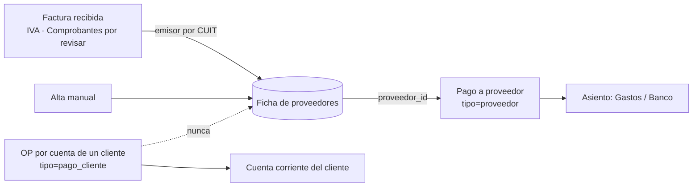

# Proveedores propios de la organización (v3.37)

Ficha de **a quién le compra la organización**. Es la base del módulo de retenciones (próximo):
para retener hay que saber quién es cada proveedor (CUIT, condición frente al IVA) y cuánto se le
pagó en el mes.

## Qué es y qué no es un proveedor

| Caso | ¿Va a la ficha? | Cómo se carga el pago |
|---|---|---|
| La organización le compra papel a una papelera | **Sí** | Pagos → "Pago a proveedor" (`tipo=proveedor`) |
| La organización paga, **por cuenta de un cliente**, una OP a un proveedor de ese cliente | **No** | Pagos → "OP por cuenta de cliente" (`tipo=pago_cliente`): va a la cuenta corriente del cliente |
| Gasto sin proveedor identificado (comisión bancaria, etc.) | No | Gasto (`tipo=gasto`) |

Organización ≠ cliente (ver CLAUDE.md → Multi-tenant). Los proveedores de los clientes no son
proveedores de la organización y no se mezclan: el backend rechaza (400) un `proveedor_id` en un
pago que no sea `tipo=proveedor`.

## Cómo entra un proveedor a la ficha

- **Al confirmar una factura en Comprobantes por revisar**: si el CUIT del emisor no está, se da de
  alta con la razón social leída (`origen=comprobantes`). Si se registra el pago, queda vinculado.
- **"Traer de las facturas"** (`POST /proveedores/sincronizar`): da de alta los emisores de las
  facturas **recibidas** en IVA que falten (las emitidas son ventas: no). Idempotente; nunca pisa
  un proveedor ya cargado (el nombre editado a mano se respeta).
- **A mano** en `/proveedores` (`origen=manual`). El CUIT es opcional (proveedor informal), pero si
  se carga se valida el dígito verificador. Un CUIT no se repite dentro de la misma organización
  (sí puede estar en otra organización: cada una tiene su ficha).

## Pagos vinculados

En Pagos ("Nuevo pago", tipo proveedor) y en Movimientos → "＋ Resolver" (pago a un proveedor
propio), el campo Proveedor sugiere los de la ficha. Si el nombre coincide con uno de la ficha
(sin distinguir mayúsculas), el pago se guarda con `proveedor_id`; si no, se registra igual con el
nombre escrito, sin vínculo. Editar un pago (`PATCH /pagos/{id}`) acepta `proveedor_id` (null lo
desvincula). El vínculo no cambia el asiento: un pago a proveedor sigue yendo a Gastos/Banco.

## Saldo por proveedor

`GET /proveedores` devuelve por proveedor:

- **Facturado**: suma de las facturas recibidas en IVA con su CUIT (`incluido`); las notas de
  crédito restan (`TIPOS_NOTA_CREDITO`).
- **Pagado**: suma de los pagos `tipo=proveedor` vinculados a la ficha.
- **Saldo** = facturado − pagado. Es orientativo: un pago sin vínculo (cargado antes de la ficha o
  con otro nombre) no cuenta.

## Permisos y datos

- Ver: `view_accounting`. Crear, editar, traer de las facturas y dar de baja: `reconcile` (igual que Pagos).
- Aislado por organización (`org_id` con `can_switch_org`). Un proveedor de otra org da 404.
- Baja lógica (`activo=false`): sus pagos y facturas quedan. `?incluir_inactivos=true` los muestra.
- Modelo `Proveedor` (`proveedores`), `Egreso.proveedor_id` (ON DELETE SET NULL). Migración 032 +
  safety net en `app/db_safety.py`. Auditoría en cada alta, edición, baja y sincronización.
- Código: `app/models/proveedor.py`, `app/services/proveedores.py`, `app/routers/proveedores.py`,
  `frontend/src/pages/Proveedores.tsx`, `frontend/src/components/CampoProveedor.tsx`.
  Tests: `backend/tests/test_proveedores.py`, `Proveedores.test.tsx`, `ResolverMovimientoModal.test.tsx`.

## Pendiente de revisar

- Retenciones (próximo): régimen por proveedor (Ganancias RG 830, IIBB, IVA, SUSS), acumulado
  mensual y certificado. Falta un TXT de SICORE de ejemplo y qué regímenes aplica cada org.
- Los pagos cargados antes de la ficha no se vinculan solos; se pueden vincular editándolos.
- Las facturas cargadas con CUIT pero no confirmadas por Comprobantes por revisar (import del
  Excel de Mis Comprobantes) no dan de alta proveedores hasta usar "Traer de las facturas".
