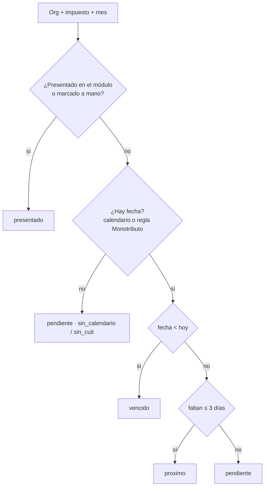

# Vencimientos — grilla por organización (v3.35)

Qué vence en el mes para cada organización que ve el usuario, con su estado. Idea tomada del
benchmark (Onvio: grilla de vencimientos; Aconpy: calendario por cliente). Código:
`services/vencimientos.py`, `routers/vencimientos.py`, `pages/Vencimientos.tsx`.

## 1. De dónde sale cada dato

| Dato | Fuente |
|---|---|
| Fecha | `calendario_vencimientos` (general, no por org): impuesto + período fiscal + bloque de terminación de CUIT → fecha. |
| CUIT | El de la org (`configuracion["cuit"]`, o el de ARCA) — `comprobantes_compra_service.cuit_organizacion`. Se carga en Comprobantes por revisar. |
| Qué le toca | `configuracion["obligaciones"]` si está (lista explícita). Si no, los módulos: Monotributo activo → `monotributo`; si no es monotributista y usa IVA (cuentas con `tasa_iva` o liquidaciones de IVA) → `iva`; IIBB activo en Convenio Multilateral → `iibb_cm`; Sueldos activo → `f931`. |
| Presentado | Módulos: `LiquidacionIva` presentada o `ProyeccionIva` presentado; `ProyeccionIIBB` presentado; `LiquidacionSueldoPeriodo` presentado (aprobado **no** cuenta). Si no, una marca manual (`vencimientos_marcados`). La cuota de Monotributo no la registra ningún módulo: solo marca manual. |

**Mes de la grilla = mes en que vence.** IVA, IIBB CM y F931 de un período vencen el mes
siguiente; la cuota de Monotributo vence en el mismo mes (`periodo_fiscal()`).

## 2. Calendario: cargado mes a mes, sin inventar fechas

ARCA **no publica un calendario anual descargable**: publica mes a mes en
`argentina.gob.ar/arca/vencimientos`, las fechas no siguen un patrón fijo y cambian por RG
(prórrogas). Por eso:

- El superadmin carga cada mes las fechas por bloque (`PUT /vencimientos/calendario`, pantalla
  "Cargar calendario"). Es general: vale para todas las orgs. Recargar un (impuesto, período)
  reemplaza sus bloques. Los bloques tienen que cubrir las terminaciones 0–9 sin pisarse.
  Bloques habituales: IVA 0-1/2-3/4-5/6-7/8-9 · F931 0-3/4-6/7-9 · CM03 0-2/3-5/6-7/8-9.
- **Monotributo** sin calendario cargado: día 20 del mes o el día hábil siguiente si cae
  sábado/domingo (`dia_habil`). **No conoce feriados**: un feriado o prórroga se corrige
  cargando la fecha, que manda sobre la regla.
- Sin fecha la celda dice `sin_calendario` (o `sin_cuit`) y queda `pendiente`: nunca se
  inventa una fecha.
- Semilla al arrancar (`sembrar_calendario_inicial`, idempotente): solo lo confirmado al
  construir el módulo — IVA, F931 y CM03 del período 2026-09 (vencen en octubre 2026).

## 3. Estados de una celda

`presentado` (módulo o manual) → `vencido` (fecha < hoy) → `proximo` (vence en ≤ 3 días) →
`pendiente`.

## 4. Endpoints y permisos

- `GET /vencimientos/grilla?mes=AAAA-MM` (`view_accounting`): orgs activas que ve el usuario —
  superadmin todas; el resto la propia + `allowed_org_ids`.
- `GET /vencimientos/calendario?periodo=|anio=` (`view_accounting`).
- `PUT /vencimientos/calendario` (`admin_accounting` **y** superadmin: es general).
- `POST` / `DELETE /vencimientos/marcar` (`manage_finance`, solo orgs accesibles). Lo
  presentado por un módulo no se desmarca desde acá.

## 5. Aviso diario

El push de las 10:00 (`backup_scheduler._run_alertas_push`) suma "N vencimientos impositivos en
3 días sin presentar" (`pendientes_proximos`). Como el resto de ese aviso, se manda a todas las
suscripciones (no filtra por org).

## Pendiente de revisar

- Ganancias / Bienes Personales (anuales), IIBB local (ARBA, AGIP) y autónomos no están: se
  agregan sumando la clave a `IMPUESTOS` y cargando sus fechas.
- El aviso diario es global (igual que las demás alertas de ese job), no por organización.
- No hay importación automática del calendario desde la web de ARCA (desde el entorno de
  desarrollo no se pudo leer el sitio).
